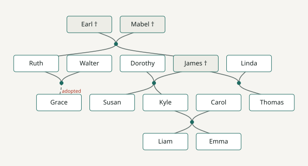

# Spike verdict: family tree layout (Gate 1)

**Decision: d3-dag. Gate 1 passes. The tree stays a tree.**

Sprint 1 · timeboxed to two days · reproduce with `node spikes/tree/layout-check.mjs`,
`node spikes/tree/decross-check.mjs` and `node spikes/tree/render-svg.mjs`.

## The question

Can the seeded family be drawn, remarriage and adopted child included, in a real
library? A layout that cannot show a person with two partners, or a child with
two parents, is a failure, not a partial success.

## The test family

The fixture is [spikes/tree/family.mjs](../../spikes/tree/family.mjs), a copy of
[supabase/seed.sql](../../supabase/seed.sql). It has 14 people in four generations
and 5 family units:

- **Remarriage.** James has Thomas with Linda (divorced), then Kyle and Susan with
  Dorothy. Thomas is a half-brother.
- **Adoption.** Grace is the adopted daughter of Ruth and Walter.
- **Deceased.** Earl, Mabel and James are dead but still hold recordings.

## Results

| | family-chart 0.9.0 | d3-dag 1.2.2 |
| --- | --- | --- |
| Data model | Per-person `parents` / `spouses` / `children`. No family-unit record. | Arbitrary DAG. People and family units are both nodes, matching our schema 1:1. |
| Everyone visible at once | **No.** The view centres on one person and shows that person's ancestors and descendants. | **Yes.** All 14 of 14. |
| People missing from the view (centred on Kyle / Emma / Ruth) | 4 / 6 / 8 of 14. From Emma's view, Thomas and Grace both disappear. | 0 |
| Remarriage | Shown only when James is the centre person. | James sits between Dorothy and Linda, with one family-unit node for each marriage. |
| Adoption | Nothing in the model can mark it. It could only be a card style. | The edge carries `adopted` and renders dashed and labelled. |
| Edge crossings | — | 0 |
| Partners side by side | — | Yes with `decrossOpt` (8 ms). The default `decrossTwoLayer` puts Kyle and Carol apart. |

The d3-dag layout of the seed:

## Why family-chart fails

family-chart is a good library for a different product. It is built to show one
person's lineage, so at any moment it hides everyone who is not in a direct line
from the centre person. We need the reverse: open the vault, see the whole family,
and see straight away which branches are empty. Its data model also has nowhere to
put a family unit or an adoption. Both are in our schema, and both are needed
again for the GEDCOM export in Sprint 8.

## What choosing d3-dag commits us to

- **We draw the cards ourselves.** d3-dag only computes coordinates. Sprint 6 renders
  an SVG in React from those coordinates: cards, family-unit dots, curved links, and
  dashed links for adoption. `spikes/tree/render-svg.mjs` is about 50 lines and is
  the starting point.
- **Pan and zoom.** Use `d3-zoom` on the SVG. This is a small, known quantity.
- **Partner adjacency needs `decrossOpt`.** It is exact and fast at family sizes. It
  grows quickly with graph size, so fall back to `decrossTwoLayer` above roughly 60
  nodes. The demo vault is far below that.
- **Generations come from layering, not birth years.** `layeringSimplex` places
  in-laws (Linda, Dorothy, Walter, Carol) on their partner's row. A person who marries
  across generations would still sit on one row. This is acceptable for the demo
  family; record it as a known limitation.
- **Below phone width the tree becomes the generation-grouped list.** This was
  already planned for Sprint 6, so the fallback gets built either way. The existing
  [FamilyTree.tsx](../../src/components/FamilyTree.tsx) grid is the starting point
  for that list.

## Follow-ups

- `d3-dag` is a runtime dependency now. `family-chart` stays a dev dependency only
  so these spike scripts can be rerun. Remove it with `spikes/` after the defence.
- Sprint 6 acceptance: four generations in the vault, remarriage and adoption
  visible without changing the centre person, click a card to open the profile.
